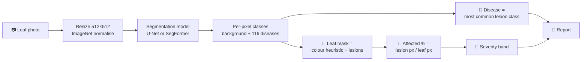
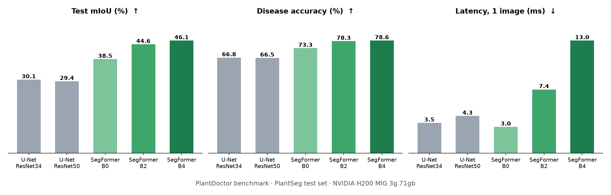
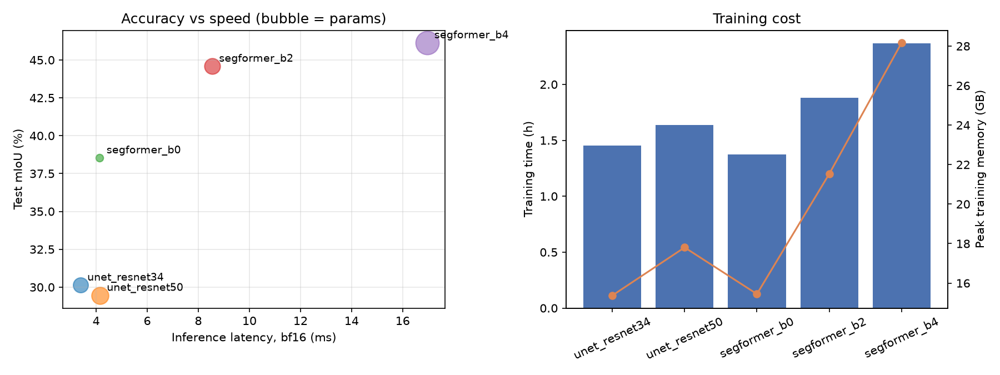
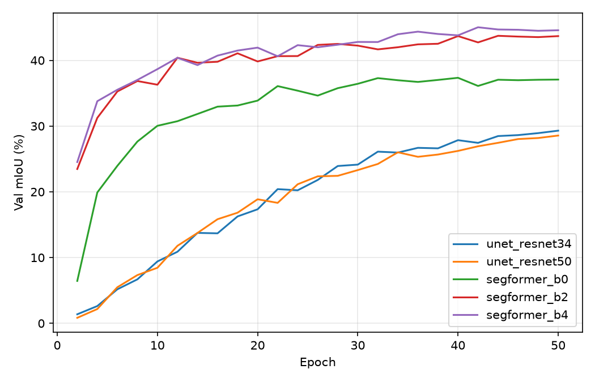

<div align="center">

# 🌿 PlantDoctor

### Plant disease segmentation benchmark: CNN vs Transformer on PlantSeg

*Find the diseased spots on a leaf, name the disease, and measure how much of the leaf is affected.*

[](https://www.python.org/)
[](https://pytorch.org/)
[](https://github.com/huggingface/transformers)
[](https://huggingface.co/aungthuhein-dev/plantdoctor-segformer-b4)
[](https://www.kaggle.com/datasets/weitianqi/plantseg)
[](https://creativecommons.org/licenses/by-nc/4.0/)

[**Results**](#benchmark-results) · [**Quick start**](#use-the-model) · [**Run on HPC**](#hpc) · [**Model card**](https://huggingface.co/aungthuhein-dev/plantdoctor-segformer-b4) · [**Experiment report**](docs/EXPERIMENTS.md)

</div>

---

## 🩺 What it does

Give PlantDoctor a leaf photo and it returns a diagnosis:

```text
Disease prediction: Early blight
Affected leaf area: 23.6%
Healthy leaf area:  76.4%
Segmentation mask:  Highlighted diseased regions
Severity:           Moderate
```

Every pixel is classified as background or one of **116 diseases** (30+ crops). The diagnosis, the affected
area and the severity level are all derived from that mask.

<table>
<tr>
<td width="33%" valign="top">

### 🔬 5 models, 1 recipe
U-Net (ResNet34 / ResNet50) and SegFormer (B0 / B2 / B4), trained with the **same** data, schedule and
loss, on the **same** GPU, so the comparison is fair.

</td>
<td width="33%" valign="top">

### 📊 10+ metrics
mIoU, Dice, precision/recall, disease accuracy, affected-area error and severity accuracy, plus
GPU memory, training time, latency and parameter count.

</td>
<td width="33%" valign="top">

### 🏆 Published winner
**SegFormer-B4**: 46.1 test mIoU, 78.6% disease accuracy. Available on the Hugging Face Hub with
a model card and inference code.

</td>
</tr>
</table>

## 🧭 How it works



| Severity | Healthy | Mild | Moderate | Severe |
|:--|:--:|:--:|:--:|:--:|
| Affected leaf area | < 1% | 1–10% | 10–30% | ≥ 30% |

> PlantSeg labels lesions but not whole leaves, so the leaf area is estimated from leaf colour plus the
> predicted lesions (`plantdoctor/analysis.py`). The percentages are approximate.

<a id="benchmark-results"></a>

## 📈 Results

Test split: 2,295 images, all models on one **NVIDIA H200 MIG 3g.71gb** slice.

<div align="center">

</div>

| Model | Params | mIoU | mDice | Lesion IoU | Disease acc | Severity acc | Train time | Train mem | Latency |
|:--|--:|--:|--:|--:|--:|--:|--:|--:|--:|
| U-Net ResNet34 | 24.5M | 30.1 | 41.8 | 64.5 | 66.8 | 71.9 | 1.45 h | 15.4 GB | 3.5 ms |
| U-Net ResNet50 | 32.5M | 29.5 | 40.7 | 64.2 | 66.5 | 72.6 | 1.64 h | 17.8 GB | 4.3 ms |
| SegFormer-B0 | 3.7M | 38.5 | 52.0 | 65.6 | 73.3 | 73.8 | 1.37 h | 15.4 GB | 3.0 ms |
| SegFormer-B2 | 27.4M | 44.6 | 58.1 | 68.1 | 78.3 | 76.5 | 1.88 h | 21.5 GB | 7.4 ms |
| 🏆 **SegFormer-B4** | **64.1M** | **46.1** | **59.5** | **69.4** | **78.6** | **77.8** | 2.37 h | 28.2 GB | 13.0 ms |

<sub>Metrics in %. Latency: batch 1, 512×512, fp32, median of 100 runs. Full table with precision, recall,
area error and bf16 latency: <a href="results/benchmark.md">results/benchmark.md</a>.</sub>

<table>
<tr>
<td width="50%"></td>
<td width="50%"></td>
</tr>
<tr>
<td align="center"><sub>Accuracy vs speed (bubble = parameters) and training cost</sub></td>
<td align="center"><sub>Validation mIoU during training</sub></td>
</tr>
</table>

### 💡 Key findings

- **Transformers win clearly.** SegFormer-B2 beats a same-size U-Net by **+14.5 mIoU**, and the tiny
  SegFormer-B0 (3.7M parameters) still beats both U-Nets.
- **Best value: SegFormer-B2.** 97% of B4's accuracy at about half the latency and 43% of the parameters.
- **Finding lesions is easy; naming the disease is hard.** Lesion IoU is 64–69% for every model; the gap
  between models comes from telling the 116 diseases apart.
- **U-Nets were still improving at epoch 50**, while all SegFormers had levelled off by about epoch 40.
- **Rare diseases are the weak spot:** 5 classes score 0% IoU and 18 are below 20%.

Full analysis: [docs/EXPERIMENTS.md](docs/EXPERIMENTS.md).

<a id="use-the-model"></a>

## 🚀 Quick start

Use the published model straight from the Hub:

```python
import torch
from PIL import Image
from transformers import SegformerForSemanticSegmentation, SegformerImageProcessor

repo = "aungthuhein-dev/plantdoctor-segformer-b4"
model = SegformerForSemanticSegmentation.from_pretrained(repo).eval()
processor = SegformerImageProcessor(size={"height": 512, "width": 512})

image = Image.open("leaf.jpg").convert("RGB")
with torch.no_grad():
    logits = model(**processor(image, return_tensors="pt")).logits
mask = torch.nn.functional.interpolate(logits, size=image.size[::-1], mode="bilinear").argmax(1)[0]
print(model.config.id2label[int(mask[mask > 0].mode().values)] if (mask > 0).any() else "healthy")
```

Or get the full report and an overlay image with this repo:

```bash
pip install -r requirements.txt
python scripts/predict.py --ckpt best.pt --image leaf.jpg --out overlay.png
```

<sub>`best.pt` is in the <a href="https://huggingface.co/aungthuhein-dev/plantdoctor-segformer-b4/tree/main">model repo</a>.</sub>

<a id="hpc"></a>

## 🖥️ Reproduce on an HPC (SLURM)

Each job uses `--partition=defq --gres=gpu:3g.71gb:1 --cpus-per-task=8 --mem=128G`.

```bash
# 1. environment (conda env "plantdoctor")
bash setup_env.sh

# 2. data: needs a Kaggle API token in ~/.kaggle/access_token (or kaggle.json)
bash scripts/download_data.sh          # -> data/plantseg/index_{train,val,test}.csv + classes.json

# 3. smoke test -> 5 training jobs -> results table (all chained)
bash slurm/submit_all.sh               # --no-smoke to skip the test, GPU=1g.35gb for another slice
squeue -u $USER

# 4. results and upload
python scripts/aggregate.py            # results/benchmark.{md,csv,png}, val_curves.png, winner.json
python scripts/push_to_hub.py --repo <hf-user>/plantdoctor-segformer-b4
```

<details>
<summary><b>Training recipe</b> (identical for every model)</summary>

| Setting | Value |
|:--|:--|
| Input | 512×512, random scale 0.75–1.5 + crop, h/v flip, brightness/contrast jitter |
| Schedule | 50 epochs, batch 16, AdamW (wd 0.01), 1,500-iteration warmup, poly decay |
| Learning rate | encoder 1e-4 (U-Net) / 6e-5 (SegFormer), head ×10 |
| Loss | cross-entropy + Dice |
| Precision | bf16 autocast, TF32, grad clip 1.0 |
| Selection | best validation mIoU (checked every 2 epochs), evaluated once on test |
| Seed | 42 |

Winner rule: highest test mIoU; models within 0.5 points of the best are decided by latency.

</details>

<details>
<summary><b>Metrics</b></summary>

| Metric | How it is measured |
|:--|:--|
| mIoU / mDice | per-class from the test confusion matrix, averaged over classes in the ground truth |
| Precision / Recall | macro-averaged per class, plus lesion-vs-background |
| Disease accuracy | majority predicted disease vs majority ground-truth disease, per image |
| Area MAE / Severity acc | affected-% error and severity-band agreement vs the ground-truth mask |
| GPU memory | peak allocated during training and during batch-1 inference |
| Training time | wall-clock time of the training epochs |
| Latency | batch 1, 512×512, median of 100 runs after 20 warm-up (fp32 and bf16) |

</details>

## 📁 Project structure

```text
plantdoctor/
├── configs/            one YAML per experiment (5 models)
├── plantdoctor/        data, models, losses, metrics, evaluation, report logic
├── scripts/            download · prepare · train · aggregate · predict · push_to_hub
├── slurm/              train / smoke / GPU-test job scripts and submit_all.sh
├── space/              Gradio demo app (Hugging Face Space, ZeroGPU-ready)
├── results/            benchmark table, charts, per-model logs and results.json
└── docs/               experiment report
```

## 📜 License and data

The training data, [PlantSeg](https://www.kaggle.com/datasets/weitianqi/plantseg), is licensed
**CC BY-NC-ND 4.0**, so the trained weights are released for **non-commercial use** (CC BY-NC 4.0).
Please cite the PlantSeg dataset if you use this work. The dataset itself is not included in this repository.

<div align="center">
<br>
<sub>Built with PyTorch, 🤗 Transformers and segmentation-models-pytorch · trained on the RSU HPC</sub>
</div>
