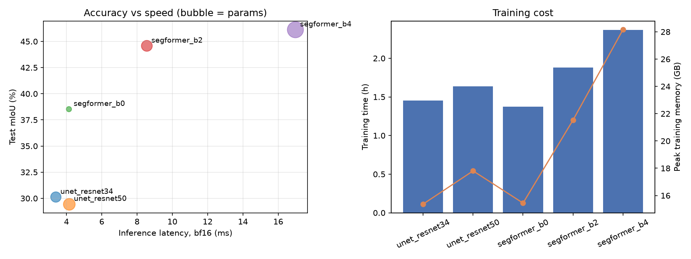
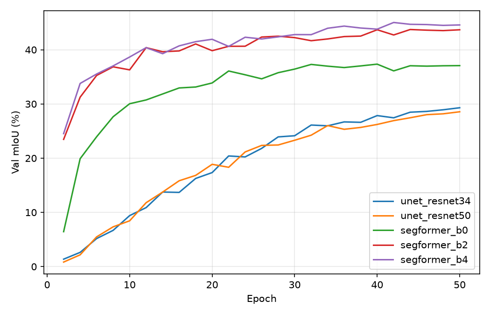

# PlantDoctor: experiment report

## 1. Question

Which architecture (CNN U-Net or Transformer SegFormer) and which size give the best trade-off between
plant disease segmentation quality and compute cost on PlantSeg?

## 2. Setup

- **Data**: PlantSeg v2 (Kaggle `weitianqi/plantseg`), official split: 7,916 train / 1,247 val /
  2,295 test images, 116 disease classes + background (115 of the diseases appear in the test split).
  Disease names come from `Metadatav2.csv` (`data/plantseg/classes.json`).
- **Hardware**: one NVIDIA H200 MIG `3g.71gb` slice, 8 CPU cores, 128 GB RAM per job (SLURM, `defq`).
  All five models ran on the same slice type, so time, memory and latency are comparable.
- **Recipe**: identical for all models: 512x512, 50 epochs, batch 16, AdamW, warmup + poly LR,
  CE + Dice loss, bf16 autocast, seed 42 (see README). Best checkpoint by val mIoU, evaluated once on test.
- **Runs**: SLURM jobs 7705-7709 (Nov 23, 2026), aggregation job 7710.

## 3. Results (test split)

| Model | Params (M) | mIoU | mIoU (disease) | mDice | Precision | Recall | Lesion IoU | Lesion Dice | Disease acc | Area MAE (pp) | Severity acc | Train mem (GB) | Train time (h) | Latency fp32 (ms) | Latency bf16 (ms) |
|---|---|---|---|---|---|---|---|---|---|---|---|---|---|---|---|
| U-Net ResNet34 | 24.5 | 30.12 | 29.61 | 41.78 | 43.29 | 42.08 | 64.47 | 78.40 | 66.75 | 8.27 | 71.90 | 15.4 | 1.45 | 3.5 | 3.4 |
| U-Net ResNet50 | 32.5 | 29.45 | 28.93 | 40.74 | 42.22 | 41.23 | 64.18 | 78.18 | 66.54 | 8.25 | 72.55 | 17.8 | 1.64 | 4.3 | 4.1 |
| SegFormer-B0 | 3.7 | 38.53 | 38.09 | 52.03 | 54.16 | 52.78 | 65.61 | 79.24 | 73.33 | 8.94 | 73.77 | 15.4 | 1.37 | 3.0 | 4.1 |
| SegFormer-B2 | 27.4 | 44.58 | 44.18 | 58.09 | 63.21 | 57.20 | 68.12 | 81.04 | 78.26 | 7.89 | 76.51 | 21.5 | 1.88 | 7.4 | 8.5 |
| **SegFormer-B4** | **64.1** | **46.13** | **45.74** | **59.51** | **63.27** | **58.84** | **69.38** | **81.92** | **78.65** | **7.43** | **77.78** | **28.2** | **2.37** | **13.0** | **17.0** |

All metrics in %, except where units are given. Latency: batch 1, 512x512, median of 100 runs.
mIoU/mDice/Precision/Recall are macro averages over classes; "Lesion" metrics merge all diseases vs background.

Raw numbers: `results/benchmark.csv`, per-model `results/runs/<model>/results.json` (incl. per-class IoU)
and `log.csv` (per-epoch loss and val mIoU).

## 4. Analysis

- **Transformer beats CNN at the same size.** SegFormer-B2 (27.4M) scores +14.5 mIoU over U-Net
  ResNet34 (24.5M). Even SegFormer-B0, with 3.7M parameters (7x fewer), beats both U-Nets by about 8.5 mIoU.
- **Size helps SegFormer, not U-Net.** B0 -> B2 gives +6.1 mIoU, B2 -> B4 only +1.6 more, for 2.3x the
  parameters and 2x the latency. ResNet50 is slightly *worse* than ResNet34 (-0.7).
- **U-Nets are under-trained.** Their val mIoU was still rising at epoch 50 (best = last epoch), while all
  SegFormers had plateaued by about epoch 35-40. With the shared 50-epoch budget the CNNs converge much more
  slowly (the ImageNet-pretrained SegFormer encoder and its lightweight decoder adapt faster). A longer
  schedule or higher LR would narrow the gap, but it is unlikely to close a 14-point difference.
- **Telling lesion from background is much easier than naming the disease.** Lesion-vs-background IoU varies
  only 64-69% across models; the big differences are in *which disease* the pixels belong to (per-class mIoU
  30-46%, image-level disease accuracy 67-79%). Transformers' global context helps classification most.
- **Cost.** Every model trained in under 2.5 h and needs under 30 GB of GPU memory. U-Net R34 and
  SegFormer-B0 are the fastest at inference (3-4 ms); B4 is the slowest at 13 ms fp32 (about 77 images/s at batch 1).
  For SegFormer at batch 1, bf16 is *slower* than fp32: small single images don't benefit and pay extra
  conversion overhead. Use fp32 (or batch several images) when deploying.
- **Per-class (SegFormer-B4).** 18 of 116 classes score below 20% IoU, and 5 score 0 (broccoli ring spot,
  coffee black rot, peach anthracnose, plum bacterial spot, zucchini yellow mosaic virus): rare classes
  with few training images. 16 classes are above 70% (e.g. bell pepper blossom end rot 87.5%, wheat loose
  smut 79.8%, corn smut 79.4%).
- **Area / severity.** The affected-leaf % is off by 7.4-8.9 percentage points on average, and the severity
  band matches the ground-truth band 72-78% of the time; better segmentation gives better severity.
  Part of the remaining error comes from the colour-based leaf mask, which is the same for every model.

## 5. Winner

**SegFormer-B4**: highest test mIoU (46.13) and best on every quality metric. The runner-up, B2, is 1.55
mIoU behind, outside the 0.5-point tolerance that would have chosen the faster model.

If deployment speed matters more than the last 1.5 points, **SegFormer-B2** is the efficient choice:
97% of B4's mIoU at 57% of its latency and 43% of its parameters.

Hugging Face: [aungthuhein-dev/plantdoctor-segformer-b4](https://huggingface.co/aungthuhein-dev/plantdoctor-segformer-b4)
(CC BY-NC 4.0, because PlantSeg is CC BY-NC-ND 4.0). The repo has the `transformers` weights, the
training checkpoint `best.pt`, `classes.json`, the `plantdoctor` package and `scripts/predict.py` for the
full report.

## 6. Limitations and future work

- One seed per model: B4 vs B2 (1.55 mIoU apart) should be repeated with 3 seeds for confidence intervals.
- U-Nets had not converged at 50 epochs; a longer or CNN-tuned schedule would make the CNN baseline fairer.
- Rare classes (5 at 0% IoU) need more data, class-balanced sampling or a loss that weights classes.
- Leaf area is a colour heuristic: a leaf-segmentation model (or leaf labels) would make affected % more accurate.
- Fixed 512x512 resize: sliding-window or multi-scale inference could help small lesions.
